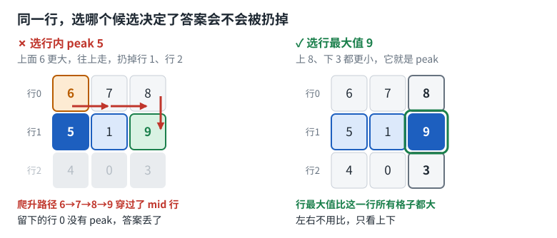
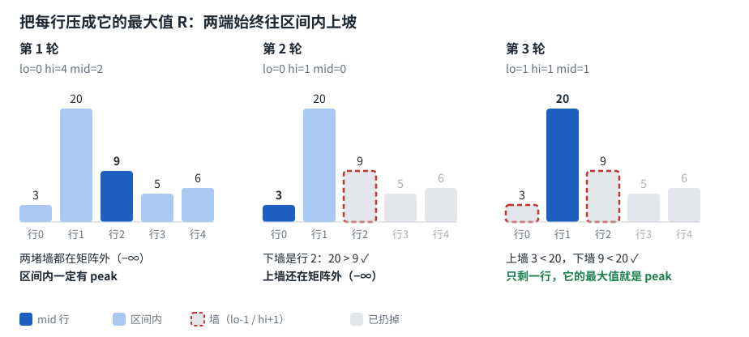

# 1901. Find a Peak Element II

前置：[162. Find Peak Element](../162.%20Find%20Peak%20Element/)
范式：二分 —— [paradigms/binary-search.md](../../blog/docs/paradigms/binary-search.md)

## 一开始的想法

```python
# 3x3 "kernel" scan? => O(mn)
# binary search style?
# reuse => naive scan find all row peak
# validate row peak in col via binary search
```

- **十字 kernel 扫一遍：** 对，也能 AC（m, n ≤ 500），但 O(mn)，不满足 follow-up 的 O(m log n) / O(n log m)。而且都 O(mn) 了，直接找全局最大值更简单
- **先扫出所有行内 peak：** 这一步已经 O(mn)，后面再快也没用
- **在列上二分验证：** 列不是有序的，没法二分。验证也不需要二分，比一下上下邻居就行，O(1)

## 做法

**二分行号**，每轮只看 mid 这一行：

| mid 行的最大值 x 和上下邻居比 | 含义 | 操作 |
|---|---|---|
| 比上下都大 | 左右也比它小，它就是 peak | 返回 |
| 上面更大 | 上半部分一定有 peak | `hi = mid - 1` |
| 否则（下面更大） | 下半部分一定有 peak | `lo = mid + 1` |

## 走一遍

![逐轮走查：先往上再往下，第 3 轮返回 [1, 1]](rounds.svg)

返回 `[1, 1]`。注意第 1 轮把行 4 的 `6` 也扔了，它其实也是 peak。

只看了 5 行里的 3 行，行 3、行 4 从头到尾没扫过。

## 为什么必须选行最大值

**任选一个行内 peak 不行。** 下面这个矩阵唯一的 peak 是 `9`：



选 `5` 后只剩行 0，但 `6 < 7 < 8`，而 `8` 下面是 `9`：行 0 没有 peak，答案被扔掉了。

问题在于**爬升路径穿过了 mid 行**：`6 → 7 → 8 → 9`。

**选行最大值就穿不过去。** 第 1 轮时，如果 `up` 比行最大值还大，它就比 mid 行所有格子都大。从 `up` 一路往更大的格子爬，数值只增不减，回不到 mid 行：


爬到停下的那格，四个邻居都比它小，所以它是整个矩阵的 peak，不只是上半部分的。

### 更正：爬升论证只够第 1 轮

之前我用这个爬升论证解释每一轮，**这是不对的**。第 2 轮起区间有两堵墙，`up` 只比新墙大，不一定比旧墙大：

```text
行0   2  1  3  2
行1   6  5  4  5
行2   5  2  5  3    ← 第 1 轮 mid，max=5，上面 6 更大，扔掉行 2~4
行3   2  3  6  2
行4   1  2  1  5
```

1. 第 2 轮 mid=0，max=3，下面的 `4` 更大，区间缩成只剩行 1。
2. 从 `4` 爬，下面就是行 2 的 `5`：**爬回了已经扔掉的行**。
3. 算法没错：第 3 轮行 1 的 max 是 `6`，上 `2`、下 `5` 都更小，返回 `[1, 0]`。

所以这堵墙的直觉只说明了第 1 轮，每一轮都成立的证明要靠下面的不变量。

## 本质：二分到底在干什么

> 我感觉我对本质还是不熟悉

二分只有三件事，这题卡住的地方正好各对应一件：

| 零件 | 决定什么 | 这题里 | 对应的疑问 |
|---|---|---|---|
| **每轮砍一半** | 轮数 `log` | 砍行号，`log m` | 对数是 max 保证的吗？不是 |
| **每轮问一个问题** | 每轮成本 | `max` 扫一行，`n` | 每一行都要选 max 吗？不用，只问 mid |
| **不变量：答案还在区间里** | 对不对 | 区间内一定有 peak | 没排序能二分吗？会错过 peak 吗？能，也没关系 |

> **二分要的不是有序，是能证明“扔掉这一半后，留下的还有答案”。** 有序只是最容易证明的一种情况。

### 不变量：两端都往区间内上坡

把每行压成一个数：`R[i]` = 第 i 行的最大值，越界当 `-∞`。全程保持：

```text
R[lo-1] < R[lo]      上墙比区间第一行矮
R[hi]   > R[hi+1]    下墙比区间最后一行矮
```

这就是 162 的**端点异号**，只是数组换成了 `R`：



**为什么区间内一定有 peak：** 取区间内的最大格子。它不小于区间内所有格子，又大于两堵墙的所有格子；相邻格子保证不相等，所以它严格大于四个邻居。

**为什么每轮都能保持：** 往上走时，`up` 比 mid 行所有格子都大，而 `R[mid-1]` 又不小于 `up`，所以：

```text
R[mid-1] >= up > R[mid]    新的下墙 mid 确实比区间最后一行矮
```

上墙没变，所以另一句也还成立。往下走完全对称。

区间也不会被走空：如果 `mid == lo` 还要往上走，就得有 `R[lo-1] > R[lo]`，这和不变量矛盾。

**为什么选 `5` 就错了：** 这一步推理的关键是 `up` 大于**行最大值**。选 `5` 时，`6 > 5` 推不出 `R[0] > R[1]`，实际上 `8 < 9`，不变量当场破了。

> 所以 max 不是优化，是这条不变量的前提。

### 换个写法：和 162 同一个循环

既然 1901 就是在 `R` 上找 peak，可以直接套 [博客里 F/T 的循环](../../blog/docs/paradigms/binary-search.md)，`pred(i)` 是 `R[i] >= R[i+1]`：

```python
class Solution:
    def findPeakGrid(self, mat: list[list[int]]) -> list[int]:
        l, r = 0, len(mat) - 2
        while l <= r:
            mid = (l + r) // 2
            if max(mat[mid]) >= max(mat[mid + 1]):  # 这一步是下坡
                r = mid - 1
            else:
                l = mid + 1
        return [l, mat[l].index(max(mat[l]))]
```

退出时 `R[l-1] < R[l] >= R[l+1]`，第 l 行的最大值就是矩阵的 peak。

- **为什么是 `>=`：** `R` 里相邻两个值可能相等，比如 `[[5,1],[1,5]]`。这不影响结果：下邻居不超过 `R[l+1]`，也就不超过 `R[l]`，而相邻格子又不相等，所以还是严格小于。
- **别提前算好整个 `R`：** 那样要 O(mn)。每轮现算两行，仍然是 O(n log m)。

和后面“代码”一节的写法相比，这版要多扫一行，也不能提前返回，但循环和 162 完全一样。**建议记这版**，少记一套。

### 从 35 到 1901，变的只有三样

| 题 | 搜索空间 | 问题 pred(i) | 凭什么能扔一半 | 每轮成本 |
|---|---|---|---|---|
| 35 | 下标 | `nums[i] >= target` | 单调，只有一条缝 | O(1) |
| 153 | 下标 | `nums[i] <= nums[-1]` | 单调，只有一条缝 | O(1) |
| 287 | **值** | `count(<= v) > v` | 单调，只有一条缝 | O(n) |
| 162 | 下标 | `nums[i] > nums[i+1]` | **端点异号**，缝可能有多条 | O(1) |
| 1901 | **行号** | `R[i] >= R[i+1]` | **端点异号**，缝可能有多条 | O(n) |

循环本身一个字都没变。

### 拿到新题问这四句

1. **在什么上二分？** 下标、值，还是行号？
2. **看一眼 mid 要回答什么问题？** 也就是 F / T 分别是什么。
3. **凭什么能扔一半？** 单调，还是端点异号？这句说不出来，就还不能写。
4. **一轮花多少？** 乘上 `log` 就是总复杂度，再和题目要求对一下。

可以拿 [540. Single Element in a Sorted Array](https://leetcode.com/problems/single-element-in-a-sorted-array/) 练这四句，它在博客的同类练习里。

## 几个容易混的点

**一行可以有几个 peak？** 要分清两个概念：

| | 定义 | 一行有几个 |
|---|---|---|
| 行内 peak | 比左右大 | 可以多个，`[5, 1, 9]` 里 `5` 和 `9` 都是 |
| 矩阵 peak | 比上下左右都大 | 可以多个，也可以没有，比如上面的行 0 |

**选行最大值不会错过别的 peak 吗？** 会，但题目要的是 **any** peak，返回一个 `[i, j]` 就行。只要留下的一半还有一个，丢掉其他的没关系。如果要找全部 peak，就不能扔任何一半，只能 O(mn)。

**对数是 max 保证的吗？** 不是，**对数来自二分，max 保证二分不出错**：

- `log m`：每轮砍掉一半行
- `n`：每轮 `max` 扫一行，这是成本
- 合起来 O(n log m)，空间 O(1)

**每一行都要选 max 吗？** 不用，只选 mid 那一行。全选就退回 O(mn) 了。

**行最大值有并列怎么办？** 只有相邻格子保证不相等，所以 `[5, 1, 5]` 可能出现。选哪个都行，证明只用到“不小于这一行所有格子”。

## 代码

```python
class Solution:
    def findPeakGrid(self, mat: list[list[int]]) -> list[int]:
        m, n = len(mat), len(mat[0])
        lo, hi = 0, m - 1

        while lo <= hi:
            mid = (lo + hi) // 2

            # 选 mid 这一行的最大值所在列
            j = max(range(n), key=lambda c: mat[mid][c])

            # 越界的邻居按 -1 处理
            up = mat[mid - 1][j] if mid > 0 else -1
            down = mat[mid + 1][j] if mid < m - 1 else -1

            # 左右已经由行最大值保证，只需比较上下
            if mat[mid][j] > up and mat[mid][j] > down:
                return [mid, j]

            # 往更大的邻居那一侧走
            if up > mat[mid][j]:
                hi = mid - 1
            else:
                lo = mid + 1
```

## 自测用例

```
[[1,4],[3,2]]                               -> [0,1]   LC 样例1
[[10,20,15],[21,30,14],[7,16,32]]           -> [1,1] 或 [2,2]   LC 样例2，两种写法返回的不同，都对
[[6,7,8],[5,1,9],[4,0,3]]                   -> [1,2]   唯一 peak，选错候选就丢答案
[[1,2,3],[4,20,6],[7,9,8],[5,3,1],[0,6,2]]  -> [1,1]   先往上再往下
[[5,1],[1,5]]                               -> 两个 5 都对   R 相邻相等
```
